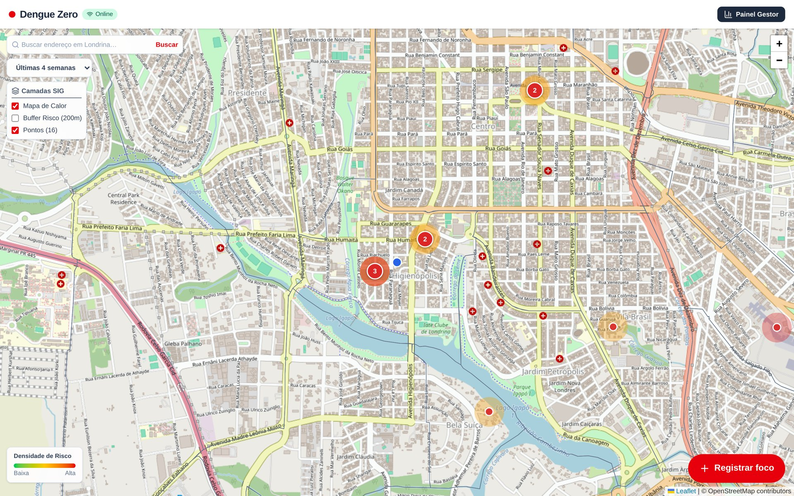
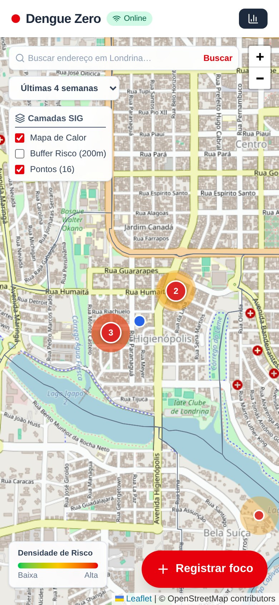
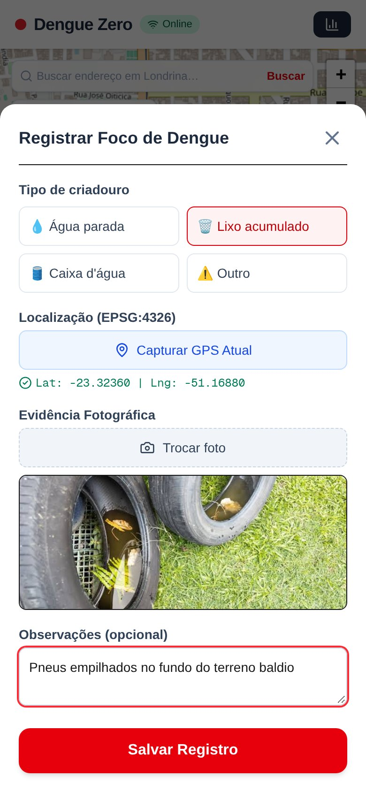
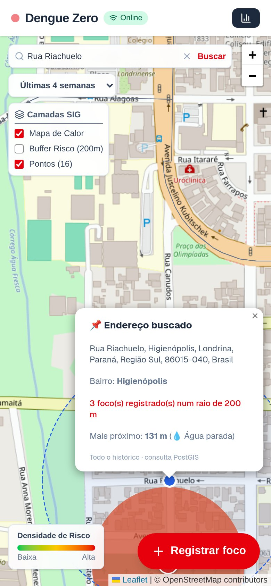

# Dengue Zero

Mapeamento colaborativo de focos do *Aedes aegypti* e análise espacial de risco em Londrina (PR).

O Dengue Zero é uma aplicação web progressiva (PWA) de vigilância colaborativa. Pelo celular, qualquer pessoa registra um possível criadouro do mosquito com a posição de GPS, uma foto e o tipo de foco. Os registros aparecem num mapa compartilhado da cidade, com camadas de análise espacial, e um painel para o gestor de saúde consolida os focos por bairro e exporta os dados para o QGIS. O registro funciona sem internet: fica guardado no aparelho e é enviado quando a conexão volta.

## Funcionalidades

| Mapa no celular | Registro de foco | Busca com raio de 200 m |
| :---: | :---: | :---: |
|  |  |  |

## Tecnologias

| Camada | Tecnologia |
| --- | --- |
| Aplicação | Next.js 16, React 19, TypeScript, Tailwind CSS 4, lucide-react |
| Mapa | Leaflet 1.9, leaflet.markercluster, tiles do OpenStreetMap |
| Geoprocessamento no navegador | Turf.js 7 (ponto-em-polígono, buffer, Haversine) |
| Offline | Dexie 4 (IndexedDB) |
| Backend | Supabase: PostgreSQL + PostGIS, Storage e Data API |
| Geocodificação | Nominatim (OpenStreetMap) |

## Pré-requisitos

- Node.js 20.9 ou mais recente
- Um projeto no [Supabase](https://supabase.com)
